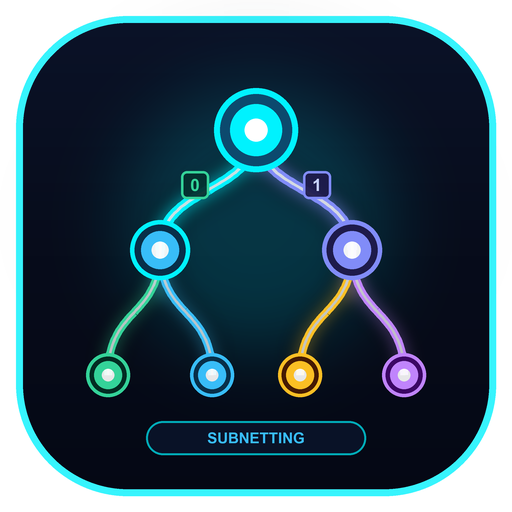

<p align="center">
  
</p>

<h1 align="center">Subnetting Calculate</h1>

<p align="center">
  <a href="https://opensource.org/licenses/MIT"></a>
  <a href="https://developer.mozilla.org/en-US/docs/Web/HTML"></a>
  <a href="https://tailwindcss.com/"></a>
  <a href="https://developer.mozilla.org/en-US/docs/Web/JavaScript"></a>
  <a href="#"></a>
  <a href="https://subnetting-calculate.vercel.app"></a>
</p>

<p align="center">
  <a href="#english">English</a> | <a href="#bahasa-indonesia">Bahasa Indonesia</a>
</p>

---

## English

> **Say Goodbye to Complex Manual Subnet Calculations.**  
> An interactive Binary Tree VLSM (*Variable Length Subnet Masking*) visualizer and calculator for Class C IPv4 networks. Design, calculate, customize, freely drag & drop nodes, and export clean hierarchical subnet trees in seconds.

🔗 **Live Demo:** [https://subnetting-calculate.vercel.app](https://subnetting-calculate.vercel.app)

### 📌 What is Subnetting Calculate?

**Subnetting Calculate** is a modern, client-side web application designed to simplify and visualize IPv4 subnetting using the **Binary Tree Method**. Rather than relying on tedious manual bit calculations or dry lookup tables, this tool renders an interactive binary decision tree where users can visually observe how host bits are borrowed (`0` for left branches, `1` for right branches) from prefix `/24` down to `/30`.

The application runs **100% in the browser**—no backend server, build tools, or external database required.

---

### 🚀 Key Features

* **🌳 Interactive Binary Tree VLSM Visualizer:**
  * **Direct Node Drag & Drop:** Click and freely move any element (subnet circles, branch nodes, or empty blocks) with your mouse to organize your tree layout cleanly.
  * **Dynamic Connectors & Bit Labels:** Connecting lines and binary path labels (`0` and `1`) stretch, curve, and follow dragged nodes in real time.
  * Automatic prefix branching from `/24` (256 addresses) down to `/30` (4 addresses) with decimal netmask indications.
* **📸 High-Resolution Diagram Export (PNG & JPG):**
  * Export the complete hierarchical tree into **PNG** or **JPG** with a single click.
  * Rendered at **2x Retina resolution** with clean dark background styling and base IP metadata—ideal for academic lab reports, documentation, or presentations.
* **🖥️ Immersive Fullscreen Mode:**
  * One-click fullscreen button or simply press the **`F`** key on your keyboard.
  * Utilizes 100% of your monitor to view wide, multi-level subnet trees clearly.
* **🎛️ Spacing & Layout Sliders:**
  * **Horizontal Branch Distance Slider:** Expand or contract spacing between branches (90px to 280px).
  * **Vertical Level Height Slider:** Adjust spacing between prefix tiers (80px to 170px).
  * Quick **Center** and **Reset Elements** buttons to return to the auto-calculated mathematical layout.
* **🌐 Real-Time Custom Class C Net ID:**
  * Support for any custom base network ID (e.g. `192.168.1.0`, `172.16.20.0`, `10.0.0.0/24`).
  * The entire tree, routing topology, and allocation table update instantaneously.
* **🔍 4th Octet Binary Decomposition (Modal Inspector):**
  * Click any tree node to inspect its 8-bit octet breakdown.
  * Clean power-of-two formula display without redundant multipliers (e.g., `2^7 + 0 + 2^5 = 128 + 32 = 160`).
  * Displays Network ID, Netmask, Usable Host Range, Broadcast Address, and reserved spare addresses.
* **🗺️ Visual Network Topology Diagram:**
  * Interactive router and LAN cloud diagrams connected directly to the allocated subnet IPs.
* **📋 Subnet Summary & Table Export:**
  * Instant copy to **Markdown** (for GitHub/Notion) or **CSV** (for Excel/Google Sheets).

---

### 🛠️ Getting Started / How to Run

#### Option 1: Direct in Browser (No Installation)
Simply double-click the file:
```
index.html
```
The application runs instantly in any modern web browser (Google Chrome, Microsoft Edge, Mozilla Firefox, Safari, Brave).

#### Option 2: Local Python Server
If you prefer running via a local web server:
```powershell
python server.py
```
Your browser will automatically navigate to `http://localhost:5173/index.html`.

#### Option 3: Deploy to Vercel / Netlify / GitHub Pages
Because this is a 100% static client-side project, you can deploy it to **Vercel** with zero configuration:
1. Push this repository to your GitHub account.
2. Go to [vercel.com](https://vercel.com) and click **"Add New Project"**.
3. Import your repository (`Subnetting-Calculate`) and click **Deploy**.

---

### 📐 The Binary Tree Subnetting Rules

1. **Down One Level:** Netmask increases by 1 (`/24 → /25 → /26...`), borrowing 1 bit from the host portion.
2. **Branch Direction:** Left branch = **Bit 0**, Right branch = **Bit 1**.
3. **Largest Allocation First:** Always allocate subnets starting with the largest host requirement to prevent block fragmentation.
4. **Host & Mask Formula:** $(2^x - 2) \ge \text{Host requirements}$, where $x$ is host bits and $\text{Netmask} = 32 - x$.

---

## Bahasa Indonesia

> **Selamat Tinggal Perhitungan Subnetting Manual yang Rumit.**  
> Aplikasi visualisator dan kalkulator VLSM (*Variable Length Subnet Masking*) interaktif berbasis **Pohon Biner** untuk jaringan IPv4 Kelas C. Rancang, hitung, sesuaikan, geser elemen secara bebas (*drag & drop*), dan unduh pohon hierarki subnet dalam hitungan detik.

🔗 **Demo Langsung (Live):** [https://subnetting-calculate.vercel.app](https://subnetting-calculate.vercel.app)

### 📌 Apa itu Subnetting Calculate?

**Subnetting Calculate** adalah aplikasi web modern berbasis *client-side* yang mempermudah pemahaman serta perhitungan subnetting IPv4 dengan **Metode Pohon Biner**. Alih-alih menghitung biner secara manual atau melihat tabel subnet yang membingungkan, aplikasi ini menyajikan pohon keputusan interaktif di mana pengguna dapat melihat langsung bagaimana bit host dipinjam (cabang kiri bernilai `0`, cabang kanan bernilai `1`) mulai dari prefix `/24` hingga `/30`.

Seluruh aplikasi berjalan **100% di browser** tanpa memerlukan backend server, compiler, atau database eksternal.

---

### 🚀 Fitur Utama

* **🌳 Visualisasi Pohon Biner VLSM Interaktif:**
  * **Geser Elemen Bebas (Direct Drag & Drop):** Klik dan tarik node mana saja (lingkaran subnet, node cabang, maupun blok kosong) untuk merapikan tata letak pohon sesuai kenyamanan Anda.
  * **Konektor & Label Bit Dinamis:** Garis kurva penghubung serta label bit `0` dan `1` otomatis melar dan mengikuti pergerakan elemen secara *real-time*.
  * Struktur percabangan prefix dari `/24` (256 IP) sampai `/30` (4 IP) lengkap dengan label subnet mask desimal.
* **📸 Ekspor Gambar Resolusi Tinggi (PNG & JPG):**
  * Simpan hasil diagram hierarki pohon subnetting ke **PNG** atau **JPG** hanya dengan 1 klik.
  * Kualitas **2x Retina** dengan latar belakang gelap rapi dan metadata IP dasar—sangat praktis dilampirkan langsung ke laporan tugas, makalah, atau presentasi.
* **🖥️ Mode Layar Penuh (Fullscreen):**
  * Masuk ke mode fullscreen lewat tombol toolbar atau cukup tekan tombol **`F`** pada keyboard.
  * Memanfaatkan 100% bidang layar monitor agar pohon subnetting berukuran besar dapat diamati dengan leluasa.
* **🎛️ Slider Pengatur Jarak & Tata Letak:**
  * **Slider Jarak Cabang (Lebar):** Renggangkan atau rapatkan jarak horizontal antar cabang (90px s/d 280px).
  * **Slider Tinggi Tingkat:** Atur jarak vertikal antar tingkatan prefix (80px s/d 170px).
  * Tombol **Pusatkan** dan **Reset Posisi Elemen** untuk mengembalikan tata letak ke posisi kalkulasi otomatis.
* **🌐 Kustomisasi IP Kelas C Bebas:**
  * Masukkan IP dasar Kelas C mana saja (contoh: `192.168.1.0`, `172.16.20.0`, `10.0.0.0/24`, dll).
  * Seluruh hierarki pohon, diagram topologi, dan tabel alokasi akan terhitung ulang seketika (*real-time*).
* **🔍 Inspeksi Biner Oktet ke-4 (Modal Biner):**
  * Klik node subnet mana saja untuk melihat pembagian 8-bit oktet ke-4.
  * Penulisan formula perpangkatan 2 bersih tanpa teks pengali yang berulang (contoh: `2^7 + 0 + 2^5 = 128 + 32 = 160`).
  * Informasi lengkap: Network ID, Subnet Mask, Range Host Valid, Broadcast ID, dan cadangan IP.
* **🗺️ Visualisasi Topologi Jaringan:**
  * Diagram router dan *cloud* LAN interaktif yang terhubung langsung dengan alokasi IP hasil pohon.
* **📋 Rekap Tabel & Ekspor Data:**
  * Salin tabel ringkasan ke format **Markdown** (untuk GitHub/Notion) atau **CSV** (untuk Excel/Google Sheets).

---

### 🛠️ Cara Menjalankan

#### Cara 1: Buka Langsung di Browser (Tanpa Instalasi Apapun)
Cukup klik ganda (*double click*) file:
```
index.html
```
Aplikasi akan langsung terbuka di browser favorit Anda (Chrome, Edge, Firefox, Safari, Brave).

#### Cara 2: Menjalankan Server Lokal Python
Jika ingin menjalankan melalui server lokal:
```powershell
python server.py
```
Browser akan otomatis membuka alamat `http://localhost:5173/index.html`.

#### Cara 3: Hosting di Vercel / Netlify / GitHub Pages
Karena proyek ini 100% berupa file statis *client-side*, Anda dapat mendeploy-nya ke **Vercel** secara gratis dalam 30 detik:
1. Hubungkan repository GitHub Anda ke [vercel.com](https://vercel.com).
2. Klik **"Add New Project"** dan pilih `Subnetting-Calculate`.
3. Klik tombol **Deploy** tanpa perlu mengubah pengaturan apapun.

---

### 📐 4 Aturan Pokok Subnetting Pohon Biner

1. **Turun Satu Tingkat:** Prefix subnet bertambah 1 (`/24 → /25 → /26...`), meminjam 1 bit dari porsi host.
2. **Arah Cabang:** Cabang kiri = **Bit 0**, Cabang kanan = **Bit 1**.
3. **Alokasikan Kebutuhan Terbesar Terlebih Dahulu:** Urutkan kebutuhan user dari yang terbanyak agar tidak terjadi fragmentasi blok IP.
4. **Rumus Kebutuhan Host & Netmask:** $(2^x - 2) \ge \text{Kebutuhan Host}$, dengan $x$ sebagai bit host dan $\text{Netmask} = 32 - x$.

---

## 📄 License

Distributed under the MIT License. See [LICENSE](LICENSE) for more information.
